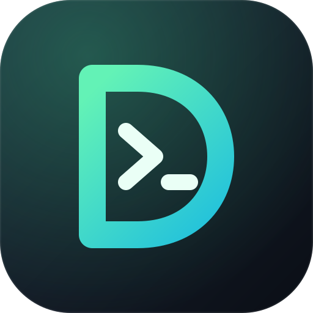

<h1 align="center">DevSetup</h1>

A desktop app (Tauri 2) that sets up a fresh Linux machine for development.
Pick your role, tick the tools, review the plan and install. It also removes what it installed.

**Status:** early development. The Debian/Ubuntu install flow is implemented but not yet tested on many machines.
Try it on a spare VM first.

Process, contribution rules and branch model live in [`CONVENTIONS.md`](CONVENTIONS.md)
(agent harnesses: [`AGENTS.md`](AGENTS.md) is auto-loaded). Roadmap and todos:
[`ROADMAP.md`](ROADMAP.md). This README stays product-only.

## Features

Legend: ✅ available, 🚧 partly done, 🗓 planned. Full details in [`ROADMAP.md`](ROADMAP.md).

**Available now**
- ✅ Role wizard: 11 roles and about 130 tools, defined in `manifest/tools.yaml`
- ✅ Tool list follows your roles, with search, "Show all", select all / deselect all
- ✅ Installed-tool detection (dpkg, Flatpak, PATH) and automatic requirements
- ✅ System / Light / Dark theme
- ✅ Install executor: one password prompt for apt, user-level steps for Flatpak, mise, npm, pipx and install scripts, live logs
- ✅ State file: only tools DevSetup installed can be removed
- ✅ Pre-flight checks: distro, pkexec, curl, reachable hosts, free disk space, apt package lookup and size estimate
- ✅ Cancel a running install and retry failed or cancelled steps (the apt step cannot be interrupted safely, so cancel waits for it)
- ✅ Removal of tools DevSetup installed: apt, Flatpak, mise, npm, pipx, and install-script tools with an uninstall command (dependents first; a tool another remaining tool needs is kept)
- ✅ Install-script pinning: each script is checked against a SHA-256 before it runs (all eight install scripts are pinned), with an optional strict mode. `npm run pin` regenerates the hashes and `npm run pin:check` reports stale ones
- ✅ Plan review: installs, removals and left-alone tools, the exact commands in the order they run (generated by the same code that runs them), apt package sizes, and a "Copy commands" button

**Phase 1: a real installer**
- ✅ Secure Boot warning, shown on the Drivers page with the steps to enroll a key
- 🗓 Polkit policy and `.deb` packaging for the root helper
- 🚧 Unit and integration tests for the plan and executor (unit tests done, end-to-end run still to do)

**Phase 2: features that set it apart**
- ✅ Save and share setups: save the selection as `devsetup.yaml`, load it from a file, pasted text or a GitHub link
- ✅ Scan this machine: find which tools from the list are installed, suggest roles, and save the result as a setup file
- ✅ Cleaner tab: unused apt packages, apt download cache, Docker prune, unused Flatpak runtimes and npm, pip, mise and Cargo caches, with the estimated space each frees shown first
- ✅ Update all: system packages, Flatpak, mise, npm globals, pipx and script-installed tools, with counts and package names shown first
- ✅ Doctor: checks that tools run and are on your terminal PATH, Docker service and group, Git identity, Flathub, the apt database, disk space and restarts, with suggested fixes

**Phase 3: post-install setup**
- ✅ Git and GitHub wizard: identity, SSH key, GitHub sign-in with the browser, adding the key to GitHub, and SSH-signed commits
- ✅ Shell setup: prompt, plugins, history defaults, completion, integrations and aliases for zsh or bash, with preview, backup and removal
- ✅ VS Code extension packs per role: 12 packs and about 50 extensions, installed one at a time through the editor's own command line
- 🗓 System tweaks: Docker group and service, file-watcher limits, Flathub, firewall, timezone
- 🚧 Drivers: read-only GPU and Secure Boot diagnostics with steps to follow yourself, plus Android udev rules as a tool for `adb` (DevSetup does not install graphics drivers automatically)

**Phase 4: Stacks tab (disposable Docker services)**
- 🗓 Stack cards per project: start, stop, destroy (containers, volumes, network)
- 🗓 Services: Redis, MongoDB, Postgres, MySQL, Kafka, RabbitMQ, MinIO, Elasticsearch, Mailpit, with GUI sidecars
- 🗓 Ready-made combos: MERN, Django + Postgres + Redis, LAMP
- 🗓 Port-conflict detection, `.env` export, volume backup and restore, idle-stack reminders
- 🗓 Connection strings with copy buttons and disk usage per stack

**Phase 5: later**
- 🗓 Command-line version: `devsetup apply devsetup.yaml`
- 🗓 Fedora, Arch and macOS support
- 🗓 Signed remote manifest updates
- 🗓 Tool detail panel with description, size and version picker
- 🗓 Installers that need sudo, such as Ollama

## Run it (Debian/Ubuntu)
    sudo apt install build-essential libwebkit2gtk-4.1-dev libxdo-dev libssl-dev libayatana-appindicator3-dev librsvg2-dev
    curl --proto '=https' --tlsv1.2 -sSf https://sh.rustup.rs | sh
    npm install
    npm run tauri dev

Run the Rust tests with `cargo test` inside `src-tauri`.
App icons live in `src-tauri/icons/` and are generated from `docs/app-icon.png` (source: `docs/logo.svg`). To change the logo, edit the SVG, export a 1024 px PNG to `docs/app-icon.png` and run `npm run icons`.

## How installing works
1. Pick roles and tools. Tools needed by a ticked tool are ticked automatically.
2. "Review plan" shows what will be installed, removed or left alone, lets you expand the exact commands, and runs the pre-flight checks.
   A failed check disables Install; warnings do not.
3. System packages (apt) run in one `pkexec` call, so you type your password once.
   The root helper (`devsetup --helper apt +id -id`) accepts only tool ids, looks each up in the built-in manifest
   and refuses anything that is not an apt tool.
4. Flatpak apps, mise tools, npm and pipx packages and install scripts run as your own user, one by one, with live logs.
5. Cancel stops the step that is running and skips the rest. System packages (apt) run as root and cannot be interrupted safely, so cancel takes effect once they finish. Failed or cancelled steps can be retried one by one or all at once.
6. DevSetup records what it installed in `~/.local/share/devsetup/state.json` and removes only those tools. (Builds from when the app was called FlashSetup used `~/.local/share/flashsetup/`; that file is still read if the new one does not exist.)

For packaged installs, copy `packaging/dev.devsetup.helper.policy` to `/usr/share/polkit-1/actions/`.

## Removing tools
Untick a tool that DevSetup installed and it appears under "Will remove" in the review. Tools you installed yourself are never removed.
- Removal runs user-level tools first (dependents before what they need, for example Codex before Node), then apt packages in the single `pkexec` call.
- A tool is kept, with a warning, while another tool that stays installed needs it.
- How each kind is removed: Flatpak `uninstall --user`, mise `unuse` and `uninstall --all`, `npm uninstall -g`, `pipx uninstall`, apt `remove`.
  Install-script tools use the `uninstall:` command in the manifest; tools without one show "remove manually".
- Configuration folders (for example `~/.claude`) are left in place.

## Setup files
Use **Save setup…** to write your selected roles and tools to a `devsetup.yaml` (or copy the text), and **Load setup…** to apply one:

    version: 1
    name: Web developer with AI tools
    roles: [web, ai]
    tools: [git, node, vscode, docker, claude]

- Load from a file, pasted text, or a GitHub link: `owner/repo` (reads `devsetup.yaml` at the repo root), a repo URL, a `blob` URL to any file, a gist, or a `raw.githubusercontent.com` URL.
- Loading **adds** to your current selection. Nothing is installed until you review and confirm the plan.
- A setup file can only name tools and roles from DevSetup's own list. It cannot carry commands, and unknown names are reported and ignored.
- See `examples/web-developer.devsetup.yaml`.

## Scan this machine
**Scan this machine…** reads what is installed (dpkg, Flatpak apps and commands on your PATH) and shows the tools from DevSetup's list that it found.
Tick what to keep, then save it as a setup file, copy it, or use it as your current selection. It is a good first step before reinstalling an OS.
- Roles are suggested when 3 or more of a role's own tools are installed. This is a simple rule, so untick any you do not want.
- Flatpak apps, global npm packages and pipx apps that are not in DevSetup's list are written into the file as comments. They are a record only; a setup file cannot restore them.
- The scan only reads. Not scanned yet: manually installed apt packages and mise tools outside the list.

## Cleaner
Open **Cleaner** in the sidebar. It scans read-only and lists what can be freed, with an estimated size for each item and the exact command it runs.
Safe items are pre-ticked; items marked "Review first" are not.
- **Unused system packages** (`apt autoremove`): shows the packages first. Read the list before you clean.
- **Downloaded package files** (`apt clean`), **Docker prune** (stopped containers, dangling images, unused networks and build cache; volumes are never touched), **all unused Docker images**, **unused Flatpak runtimes**, and the **npm**, **pip**, **mise** and **Cargo** caches.
- Apt operations run in one `pkexec` call (one password prompt) through the same restricted helper as installs. It only accepts two fixed operations.
- Cache folders are emptied only inside your home folder, links are never followed, and a symlinked folder is refused.
- Sizes are estimates: Docker's figures are its own, and Flatpak does not report sizes. Volumes, project folders and `target` or `node_modules` directories are never touched.

## Updates
Open **Updates** in the sidebar. It checks read-only and lists, per source, how many updates exist and which packages (where that can be checked ahead of time). Tick what to update.
- **System packages**: `apt-get update` and `apt-get upgrade -y` in one `pkexec` call, keeping your existing config files. Package lists are refreshed first, so the count can be lower than what you get.
- **Flatpak** (your user installs), **mise tools** (`mise upgrade`), **global npm packages** (`npm update -g`), **pipx apps** (`pipx upgrade-all`).
- **Script-installed tools** (mise, Bun, Deno, uv, rustup, Claude Code, OpenCode) run their own update command. It does nothing when the tool is current.
- Each item updates everything of its kind on the machine, not only tools from DevSetup's list.
- Upgrading Node with mise installs a new Node version, and global npm packages from the old one are not carried over. Install them again afterwards. The item warns you when Node is among the updates.

## Doctor
Open **Doctor** in the sidebar. The checks only read. Each finding shows what was found and how to fix it. Fixes are one click, one password prompt, or lines to copy.
- **Installed commands run**: command-line tools are run with `--version`. Only a command that cannot run, crashes, or reports a missing file or library counts as broken. GUI apps are never started.
- **Terminal PATH**: tools installed into your home folder (mise, uv, Claude Code, Bun, Deno, rustup) are looked up from a fresh interactive `$SHELL`. If some are missing, it gives you the lines to add to your shell's rc file instead of editing it for you.
- **Docker**: the service is running and enabled (fix: `systemctl enable --now docker`), and you are in the `docker` group (fix: `usermod -aG docker`, with a warning that the group is root-equivalent). The helper only changes the user who started it.
- **Also**: tools DevSetup installed that have since disappeared, Git name and email, the Flathub remote (fix adds it for your user), `apt-get check`, free disk space, and a pending restart.

## Git and GitHub
Open **Git and GitHub** in the sidebar. Every step is optional and only changes your own settings.
1. **Identity**: `user.name`, `user.email` and, if you like, `init.defaultBranch main`, written with `git config --global`.
2. **SSH key**: creates `~/.ssh/id_ed25519` and never overwrites an existing key. Only public keys (`*.pub`) are ever read, shown or sent. A passphrase is optional and is passed to `ssh-keygen -N`, so other users on a shared machine could see it in the process list for a moment; you can also add one later with `ssh-keygen -p`. "Test connection" connects to `git@github.com` and trusts GitHub's host key the first time (`StrictHostKeyChecking=accept-new`).
3. **GitHub sign-in**: runs `gh auth login --web`. DevSetup shows the one-time code and an "Open github.com/login/device" button (a fixed page, never a link from elsewhere). With HTTPS it also runs `gh auth setup-git`. You can then add your SSH key to your account.
4. **Signed commits**: `gpg.format ssh`, `user.signingkey`, `commit.gpgsign true` and an `allowed_signers` file in `~/.config/git/` so `git log --show-signature` works. For GitHub's Verified badge the key must also be added as a signing key, which needs the `admin:ssh_signing_key` permission.
- Values are validated and passed as arguments, never through a shell. Key paths must be `.pub` files directly inside `~/.ssh`.

## Shell setup
Open **Shell setup** in the sidebar.
- **What it edits:** one block between `# >>> devsetup shell >>>` and `# <<< devsetup shell <<<` in `~/.zshrc` or `~/.bashrc`. Nothing outside the markers is touched. The first time, your original is copied to `~/.zshrc.devsetup-backup` (or `.bashrc`). If the file is a symlink (for example from a dotfiles repository), the file it points to is edited and the link stays.
- **Options:** history defaults, completion, Starship prompt, zsh-autosuggestions and zsh-syntax-highlighting (zsh only, with syntax highlighting kept last as that plugin requires), zoxide, fzf key bindings, direnv, mise, handy aliases and Git aliases.
- **Safe without the tools:** every line checks that the program or plugin file exists first, so a missing tool does nothing. "Tick them in Setup" selects the missing ones for the usual reviewed install.
- **Preview, Update, Remove:** Preview shows the exact block and warns if your file seems to configure the same thing already. Applying again replaces the block. Remove deletes it. A block with a missing or duplicated marker is refused instead of guessed at.
- **Login shell:** "Make zsh my login shell" runs through the root helper (one password prompt) and only accepts zsh or bash that are listed in `/etc/shells`. Log out and back in afterwards.
- fish is not supported yet.

## VS Code extensions
Open **VS Code** in the sidebar. DevSetup finds VS Code or VSCodium (the `code` or `codium` command, or the Flatpak) and lists extension packs from `manifest/extensions.yaml`.
- Packs for the roles you picked in Setup, plus an Essentials pack, are ticked. Extensions that are already installed are shown as installed and are not touched.
- Each extension is installed with `<editor> --install-extension <id>`, one at a time, with live logs, cancel and retry. A Flatpak editor runs through `flatpak run`.
- Only ids that are listed in the manifest can be installed, and an id must look like `publisher.name`, so nothing else can reach the command.
- Add or change extensions by editing `manifest/extensions.yaml`. An id the marketplace does not know shows up as a failed step with the reason in the log.
- VSCodium uses the Open VSX registry, which does not carry every Microsoft extension, so some steps may fail there.

## Drivers
Open **Drivers** in the sidebar. It reads your graphics hardware, the kernel driver each GPU uses, Secure Boot, and whether your apt sources include `non-free`. It then shows steps to follow yourself.
- **Read-only.** DevSetup does not install graphics drivers: a failed driver install can leave a machine without a desktop, and the right steps depend on your hardware.
- **NVIDIA:** if the GPU runs on `nouveau` or no driver, you get the Debian steps (enable `non-free` and `non-free-firmware`, install `nvidia-driver` and `firmware-misc-nonfree`) or `ubuntu-drivers install` on Ubuntu, and the Secure Boot Machine Owner Key steps when Secure Boot is on. A working driver on a hybrid laptop gets the PRIME offload variables, plus notes on CUDA and the NVIDIA Container Toolkit.
- **AMD and Intel:** whether the expected kernel driver (`amdgpu`, `i915` or `xe`) is in use, and the AMD firmware package when relevant.
- **Android phones:** the udev rules that fix an adb device listed as "no permissions". They are also a tool under Mobile in Setup ("Android udev rules").
- Commands are text with a Copy button. Nothing on this page runs a command.

## Install-script pinning
Some tools install by running a script from the internet (mise, Bun, Deno, uv, rustup, Claude Code, OpenCode, Ollama).
- A tool can carry `sha256: "<hash>"` in `manifest/tools.yaml`. DevSetup downloads the script, compares its SHA-256 and
  **refuses to run it on a mismatch**. Scripts without a pin run as downloaded and show a warning in the checks.
- The review screen has a strict option: "Only run install scripts that have a pinned checksum".
- `npm run pin` downloads every script (with the same `curl` call the app uses) and writes the hashes into the manifest.
  `npm run pin:check` only reports scripts that changed upstream (exit code 1), so CI can flag stale pins.
  Review the diff of a changed script before committing its new hash.
- Trade-off: vendors update their scripts often, so a pin can go stale and the install fails with a checksum mismatch until the
  pin is refreshed. That is the intended behavior, and it is why the weekly dependency-audit workflow also runs `npm run pin:check`.
- `mise`, `npm` and `pipx` tools accept an optional `version:` in the manifest (for example `{ type: mise, tool: "node", version: "22" }`).

## Tools and roles
`manifest/tools.yaml` holds roles and tools. A tool's `roles` list decides when it is shown:
a role id, `all` (always shown and pre-ticked) or `any` (shown once any role is picked).
GUI apps use Flatpak, CLI tools use apt, mise, npm, pipx or an install script.
`cargo test` checks that the manifest parses and that tool ids, roles and `requires` are consistent.

## Layout
- `manifest/tools.yaml`: roles and tools; `manifest/extensions.yaml`: VS Code extension packs
- `src-tauri/src/`: `manifest.rs`, `system.rs` (distro and installed detection), `plan.rs`, `preflight.rs`, `review.rs` (review details), `exec.rs` (executor), `helper.rs` (root helper), `state.rs`, `setup.rs` (setup files), `scan.rs` (machine scan), `clean.rs` (cleaner), `update.rs` (updater), `doctor.rs` (health checks), `gitwiz.rs` (Git and GitHub wizard), `shellcfg.rs` (shell setup), `vscode.rs` (VS Code extension packs), `drivers.rs` (driver diagnostics), `lib.rs` (commands)
- `src/api.ts`: the only frontend file that talks to Tauri
